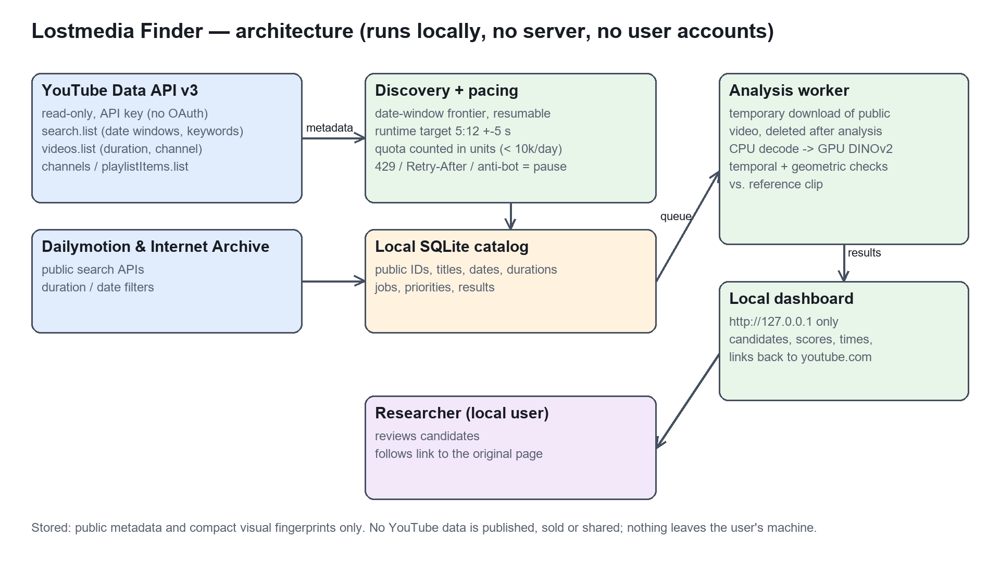
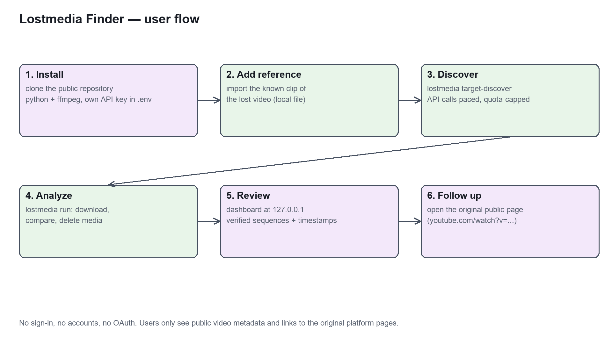

# Lostmedia Finder

Outil Python local de recherche d'extraits vidéo, testé sur la RTX 5090 de ce poste. Licence MIT pour le code ; les vidéos et les modèles gardent leurs licences propres. Les fichiers téléchargés ne sont pas distribués dans le dépôt.

> **This tool uses YouTube API Services** (read-only, API key, no OAuth). **[Privacy Policy](PRIVACY.md)** · **[Terms of Use](TERMS.md)** · [YouTube Terms of Service](https://www.youtube.com/t/terms) · [Google Privacy Policy](https://policies.google.com/privacy)

Confidentialité : [PRIVACY.md](PRIVACY.md) · Conditions : [TERMS.md](TERMS.md).

## Mise à jour du 21/10/2026 (fin de journée)

- **Débit** : pipeline à trois étages (téléchargements en threads, décodage/prétraitement CPU en processus à un thread, GPU dans le processus principal). Prétraitement identique au bit près à celui du processeur Hugging Face, donc les empreintes existantes restent valides. Plafond de slots par plateforme. Mesuré : 11 → ~50 vidéos/min ; le goulot est désormais la cadence de téléchargement imposée par plateforme, pas la machine.
- **Cadence adaptative** (`lostmedia/tuning.py`) : intervalle par plateforme qui monte par paliers après une fenêtre saine (≥ 8 min, ≥ 60 tentatives) et redescend au dernier palier stable sur 429 / anti-bot, avec `Retry-After` ou backoff exponentiel. YouTube a déclenché sa vérification anti-bot à 3 s / ~8 téléchargements parallèles : il repart à 4 s. Hôte injoignable (3 timeouts de suite) → pause exponentielle, jobs conservés.
- **Détection** : référence échantillonnée toutes les 0,25 s (`reference_interval`) et vues fines d'angle 45 % / 30 % (`crops = "fine"`), vérification SIFT sur la vue appariée et dans les deux orientations. Banc difficile `scripts/validate_hard.py` (19 inserts, 7 vidéos SM64 en négatifs, intervalle de production 2 s) : rappel 26 % → **84 %**, **0 faux positif / 8**. Manqués : miroir + incrustation 35 %, incrustation 25 %, extrait de 5 s.
- **Découverte 15–31 août 2007 terminée pour les méthodes configurées** : 33 220 vidéos (Dailymotion 29 502 avec subdivision horaire, YouTube 1 603, Archive 2 115). Bilan : `python scripts/period_report.py --period 2007-08-15`.
- **Campagne ciblée « réuploads »** (`lostmedia/targeted.py`, `scripts/target_campaign.py`) : toutes les vidéos de 5:12 ± 5 s (307–318 s) du 15/08/2007 au 31/12/2014. Dailymotion filtre la durée côté serveur ; YouTube par mots-clés + durée exacte via `videos.list`. Ces vidéos passent en tête de file (`jobs.priority`), sans exclure les autres.
- **Quota YouTube compté en unités** (search = 100, videos/playlistItems/channels = 1 ; budget local 9 500/jour, jour aligné sur minuit Pacifique).

Les sections ci-dessous décrivent l'état de la première transmission et restent valables sauf mention contraire ci-dessus.

**Reprise par un autre agent : lire [HANDOFF.md](HANDOFF.md) en premier.** Ce fichier contient l'état exact du 21/10/2026, les services ouverts, les limites connues et les prochaines corrections. Les compteurs finaux sont dans [reports/final-audit.json](reports/final-audit.json) ; les rapports antérieurs sont des instantanés de développement.

État validé à la première transmission : **9 975 entrées uniques découvertes** sur le 15–31 août 2007 (YouTube 1 260, Dailymotion 6 600, Archive 2 115 items), **67 vidéos analysées**, 19 ignorées par les limites du test, 1 inaccessible, 9 888 en attente, aucun worker actif. **17 tests réussis.** Aucune séquence BSS validée dans ces vidéos réelles ; les quatre détections BSS sont celles du test d'insertion contrôlé.

Le benchmark élargi utilise **34 874 vecteurs** et les **67 vidéos réelles** comme distracteurs. FP16 conserve 99,88095 % du top-10 FP32 et retrouve 4/4 inserts ; le PQ testé conserve 81,90476 % et retrouve 3/4 inserts. FP16 reste le réglage par défaut. Voir [reports/compression.json](reports/compression.json) pour les mesures et leurs limites.

**Périmètre actuel : validation sur le 15–31 août 2007. Les périodes suivantes sont verrouillées par `campaign_through = "2007-08-31"`.** Le plan complet prépare ensuite septembre–décembre 2007 et 2008–2012. Un état `exhausted` signifie seulement que les méthodes de recherche configurées ne renvoient plus de pages. Il ne signifie jamais que toutes les vidéos de cette période sont connues.

## Démarrer sur ce poste Windows

```powershell
cd .
.\.venv\Scripts\lostmedia serve --data data/chronological --port 8765
```

Ouvrir <http://127.0.0.1:8765>. Le service écoute uniquement sur l'interface locale. Importer des références ou vidéos dans l'interface, lancer une découverte bornée, puis l'analyse. La campagne peut être arrêtée après le lot courant. L'interface expose candidats, scores non probabilistes, couples de miniatures, horodatages, sources, erreurs, GPU et stockage.

Installation sur une autre machine : `powershell -File scripts/install-windows.ps1`. Dans Ubuntu WSL2 : `bash scripts/install-wsl2.sh`. **Le script WSL2 n'a pas été exécuté dans cet environnement Windows.** FFmpeg/ffprobe doivent être dans PATH. Python 3.11+ requis. La version CUDA de PyTorch est installée séparément pour éviter de remplacer silencieusement un paquet CPU.

Les dépendances effectivement utilisées sont recensées dans `requirements-tested-windows.txt`. Ce relevé Windows n'est pas un verrou multi-plateforme.

## Référence BSS et validation reproductible

Référence fournie par l'utilisateur : <https://www.youtube.com/watch?v=NndwzzpMunQ>. Le test prend les secondes **30–42**, les insère à **73 secondes** dans une vidéo de **180 secondes**, puis cherche sans fournir au détecteur l'emplacement d'insertion. L'arrière-plan provient d'un extrait public de Big Buck Bunny répété ; c'est un corpus contrôlé, pas un échantillon représentatif du Web.

```powershell
.\.venv\Scripts\python scripts/validate.py --backend dinov2 --extended
.\.venv\Scripts\python scripts/validate.py --backend clip --extended
.\.venv\Scripts\python scripts/validate.py --backend phash --extended
.\.venv\Scripts\python scripts/benchmark_compression.py
.\.venv\Scripts\python -m pytest -q
```

Chaque validation crée une nouvelle base afin de ne pas confondre vitesse d'inférence et réutilisation du cache. Rapports machine dans `data/validation/report-*.json`, rapports de livraison dans `reports/`. Variantes : recadrage 20 % + forte compression, miroir, incrustation, vitesse ×1,25 ; témoin sans BSS. Le rappel mesuré est la proportion d'inserts retrouvés avec erreur d'offset ≤2 s. Une concordance visuelle isolée ne compte pas comme détection validée.

## Recherche et reprise

```powershell
# Référence locale conservée ; aucune copie de l'original n'est nécessaire.
.\.venv\Scripts\lostmedia import chemin\extrait.mp4 --reference --data data/chronological

# Clé YouTube dans .env, fichier exclu de Git. Ne pas mettre la clé dans une URL de rapport.
# YOUTUBE_API_KEY=...

# Recherche officielle bornée, par mois, dates inclusives.
.\.venv\Scripts\lostmedia discover dailymotion --query video --start 2007-08-15 --end 2007-08-31 --pages 3 --data data/chronological
.\.venv\Scripts\lostmedia discover youtube --query tutorial --start 2007-08-15 --end 2007-08-31 --pages 2 --data data/chronological

# Audit sans mots-clés ; arrêt dur au 31 août 2007.
.\.venv\Scripts\python scripts/discovery_audit.py --calls 30
.\.venv\Scripts\python scripts/youtube_audit.py

# Traitement borné ou campagne reprenable. --watch attend entre les lots.
.\.venv\Scripts\lostmedia run --limit 10 --data data/chronological
.\.venv\Scripts\lostmedia campaign --watch --pages 3 --analysis-limit 10 --data data/chronological
.\.venv\Scripts\lostmedia campaign-progress --data data/chronological
.\.venv\Scripts\lostmedia status --data data/chronological
```

Arrêt sûr : bouton d'arrêt ou création de `data/chronological/STOP`. Retirer ce fichier pour reprendre en CLI. Un crash laisse un bail de travail expirant ; le prochain lancement récupère la tâche. Un redémarrage du PC nécessite de relancer la commande : aucun service système ni tâche planifiée Windows n'est installé. Les vidéos terminées sont ignorées automatiquement. Les échecs transitoires sont réessayés au maximum trois fois par la campagne ; les erreurs restent visibles.

La chronologie traite une période à la fois. Les fenêtres saturées passent de mois à semaines de sept jours, puis à jours. Une saturation quotidienne est explicitement conservée comme lacune. Les quotas et refus d'accès ne sont jamais contournés. Les requêtes sont espacées par plateforme, les 429/5xx sont réessayés avec attente, le budget YouTube local vaut 80 appels/jour UTC et peut être inférieur au quota du projet. Il ne remplace pas les compteurs du fournisseur.

Pour Internet Archive, le filtre utilise **`publicdate`**, date de publication publique dans Archive, pas `date`, souvent date du contenu original. Un objet Archive peut contenir plusieurs fichiers : **le compteur représente des entrées de catalogue `mediatype:movies`, pas un nombre certifié de fichiers vidéo distincts**. Actuellement un fichier compatible est choisi par entrée. L'expansion de tous les fichiers d'un item reste à implémenter.

## Méthodes complémentaires

```powershell
# Playlist ou chaîne : API officielle, curseurs persistants, date originale d'upload.
.\.venv\Scripts\lostmedia explore PLAYLIST_ID --pages 2 --data data/chronological
.\.venv\Scripts\lostmedia explore CHANNEL_ID --channel --pages 2 --data data/chronological

# Archives publiques d'identifiants, sans charger tout le catalogue en mémoire.
.\.venv\Scripts\lostmedia import-catalog public-export.jsonl --data data/chronological
```

Format JSONL : `{"source":"youtube","id":"ID","title":"Titre","published":"2008-02-03"}` ; sources `youtube`, `dailymotion`, `archive`. Les dates inconnues sont comptées séparément et non importées sauf `--allow-unknown`. Les catalogues et playlists ne sont pas automatiquement recherchés sur le Web : fournir leurs fichiers ou identifiants. Les chaînes/playlists ont des tests de contrat ; consulter le rapport d'intégration pour les parcours réellement exécutés avec l'API.

## Détection, stockage et GPU

- DINOv2-base par défaut ; alternative CLIP ViT-B/32 ; pHash 64 bits en complément. Inférence par lots de 32, BF16 sur CUDA, réduction récursive du lot en cas de manque de VRAM. CPU possible.
- Décodage séquentiel horodaté, images toutes les 2 s par défaut ; 1 s dans le test BSS. Sept vues par image : entière, miroir et cinq recadrages. Une copie à très petite échelle ou un extrait plus court que l'intervalle peut être manqué.
- FAISS Flat et Binary pour présélection des correspondances ; consensus multi-images, ordre temporel et vitesses 0,5–2 ; SIFT/RANSAC pour vérifier la géométrie. Les scores sont des heuristiques de classement, jamais des probabilités d'identité.
- Empreintes **FP16** compressées en NPZ, pHash, temps et identifiants persistants. Téléchargement temporaire, analyse, commit des résultats, puis suppression du fichier sous le répertoire géré `media/`. Les fichiers locaux fournis par l'utilisateur et les références sont préservés. Les miniatures sans correspondance sont supprimées. Une nouvelle référence peut réutiliser les vecteurs et retélécharger seulement les preuves nécessaires à une vérification géométrique.
- Budget 500 Gio et plancher 5 Gio libres dans `config.toml`. Arrêt sûr si le budget est insuffisant. Une vidéo est encore téléchargée sur disque avant décodage : **ce n'est pas un décodeur HTTP sans fichier intermédiaire**. Le budget inclut la racine de données choisie, pas l'environnement Python, les modèles Hugging Face ni les autres jeux de validation. Les téléchargements partiels d'une tentative en erreur restent disponibles pour reprise.
- Deux téléchargements préchargés pendant l'inférence GPU. Un seul worker GPU par racine via verrou CLI. Les scripts d'audit doivent être exécutés séparément pour comparer des débits reproductibles.

Pour des index de corpus indépendants :

```powershell
.\.venv\Scripts\lostmedia build-index SIGNATURE --shard-size 100000 --data data/chronological
.\.venv\Scripts\lostmedia search-index fichier_features.npz SIGNATURE --k 10 --data data/chronological
```

Les index HNSW sont segmentés et recherchés segment par segment ; le manifeste est publié atomiquement. Le benchmark compare FP32, FP16, int8 et FAISS PQ 96×8 bits. **PQ est expérimental et n'est pas le stockage de production par défaut.** Reconstruire l'index n'exige pas de recalculer les embeddings. Les anciennes générations d'index ne sont pas effacées automatiquement.

## Limites et travaux restants

Le logiciel fonctionne de bout en bout sur le corpus testé. Il n'est pas validé pour des millions ou centaines de millions de vidéos. SQLite, les compteurs de fichiers, les index HNSW et les embeddings par frame devront être reconsidérés à cette échelle ; 500 Gio ne suffisent pas à conserver les embeddings multi-vues de centaines de millions de vidéos. Les estimations de stockage ne concernent que la file **déjà connue**, sans extrapoler le nombre inconnu de vidéos publiques.

La cascade actuelle évite les conclusions sur titre/miniature, mais elle calcule les embeddings de chaque vidéo admissible. Une passe globale légère avec politique de rappel mesurée, des index PQ/OPQ de production, une exploration automatique de liens entre chaînes, un backend distribué et une meilleure couverture des incrustations miroir combinées restent à développer. L'intervalle temporel, les petits overlays et les scènes de jeu très similaires limitent toujours le rappel et la précision. Aucun « BSS retrouvé » ne doit être annoncé à partir d'un simple score.

## Architecture

`discovery.py` : connecteurs, quotas et dates ; `catalogs.py` : exports et playlists ; `chronology.py` : frontières de recherche ; `db.py` : SQLite WAL, déduplication, baux ; `media.py` : acquisition/décodage ; `features.py` : GPU/cache ; `matching.py` : vérification ; `storage.py` : conservation/nettoyage ; `worker.py` : file ; `indexing.py` : segments FAISS ; `web.py` : API locale et interface ; `scripts/` : installations et audits ; `tests/` : contrats, reprise, limites, sécurité web, index et temporalité.

## Sources techniques

- [API YouTube Search](https://developers.google.com/youtube/v3/docs/search/list)
- [API Dailymotion](https://developers.dailymotion.com/v0/reference/perform-an-api-call)
- [Recherche Internet Archive](https://archive.org/advancedsearch.php)
- [DINOv2 dans Transformers](https://huggingface.co/docs/transformers/model_doc/dinov2)
- [PyTorch CUDA](https://pytorch.org/get-started/locally/)
- [yt-dlp et ses dépendances](https://github.com/yt-dlp/yt-dlp)

Les rapports et états de tests de ce dépôt priment sur toute liste de fonctionnalités souhaitées.

## Schémas




